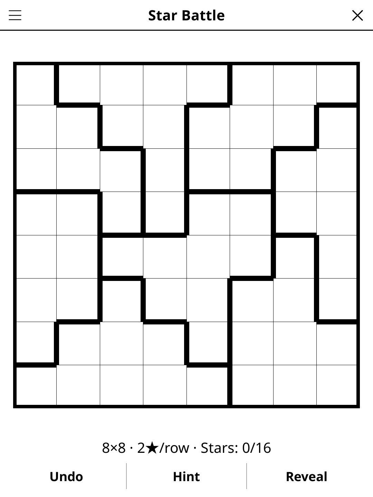

# starbattle.koplugin

A Star Battle puzzle plugin for [KOReader](https://github.com/koreader/koreader).

## Screenshot

## Rules

Place exactly N stars per row, column, and bold outlined region. No two stars may be adjacent — including diagonally adjacent. Tap a cell to cycle: star → empty marker → blank.

## Features

- **1-star and 2-star variants**
- **Multiple grid sizes** — 6×6 (1 star), 8×8 and 10×10 (2 stars)
- **No guessing** — every puzzle can be solved by reasoning alone, and has exactly one solution
- **Non-adjacency check** — highlights conflicting stars
- **Auto-save** — puzzle state saved and restored on next launch
- **Hint** — two taps: the first says which cell is about to give, the second acts on it. A cell that contradicts the solution is always reported before a fresh one is revealed

## Installation

1. Download `starbattle.koplugin.zip` from the [latest release](../../releases/latest).
2. Extract into the `plugins/` folder of your KOReader data directory.
3. Restart KOReader.
4. Open the menu → **Tools** → **Star Battle**.

## Controls

| Action | How |
|--------|-----|
| Place star / mark empty / clear | Tap cell (cycles) |
| Check progress | Tap **Check** |
| New puzzle | Tap **New game** |
| Show rules | Tap **Rules** |

## How puzzles are made

A star placement is drawn first, then the regions grow around it, some of
them kept small. A logic solver that never guesses then works through the
grid using only a player's deductions: a star empties its eight
neighbours; a full row, column or region has no more stars; the ways a
row, column or region can still place its stars; and counting the regions
that fit inside a band of rows or columns. Where it gets stuck, a cell
moves to a finished neighbouring region and it tries again. A puzzle is
kept only once the solver fills the whole grid, which also proves its
solution unique. Should that ever fail, a stored puzzle of the chosen size,
checked the same way, is used instead.

## License

GPL-3.0 — see [LICENSE](LICENSE).
